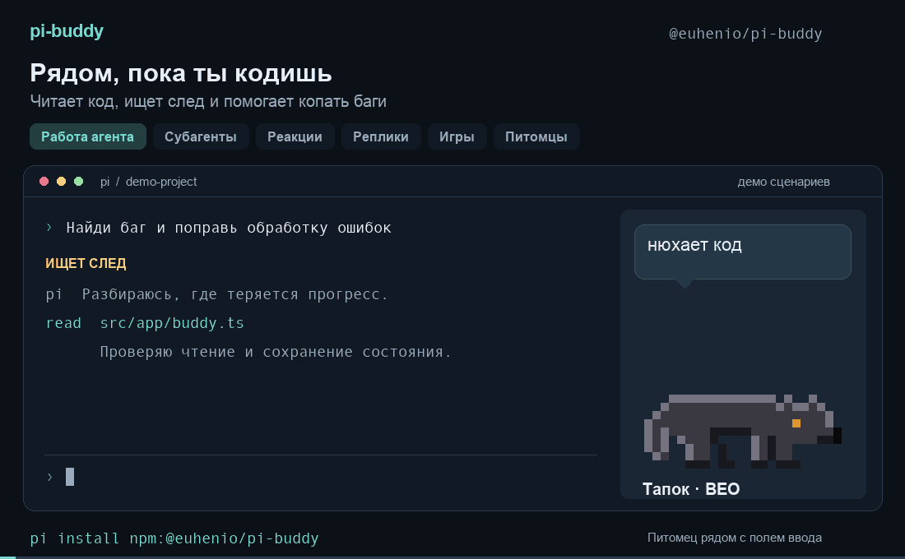

# @euhenio/pi-buddy

[Русский](README.ru.md) · English

A terminal tamagotchi for [pi](https://pi.dev). Your pet lives beside the input and reacts to the coding agent: walks while it works, celebrates successful turns, gets sad about errors, and naps when idle.

[Source on GitHub](https://github.com/e-davidenko/pi-buddy) · [Report an issue](https://github.com/e-davidenko/pi-buddy/issues/new)



*30 seconds of the main features using the actual pet sprites. Staged demo; recorded with Russian speech.*

## Install

```bash
pi install ./pi-buddy                              # local directory
pi install git:github.com/e-davidenko/pi-buddy      # git
pi install npm:@euhenio/pi-buddy                   # npm
```

Try without installing: `pi -e ./pi-buddy`.

If you previously installed `~/.pi/agent/extensions/buddy.ts` manually, remove that old file to avoid duplicate `/buddy` commands. Your pet stays in `~/.pi/agent/buddy.json`.

## Language

```text
/buddy lang en
/buddy lang ru
/buddy lang auto
/buddy lang
```

English and Russian cover the interface, pet speech, toys, species labels and phrase learning. Commands and IDs stay the same in both languages. Pet names are kept as entered.

New installations use `auto`: the first nonempty `LC_ALL`, `LC_MESSAGES` or `LANG` determines the language. Russian regional locales select `ru`; other locales, including `C` and `POSIX`, select `en`. Existing pets without a language setting keep Russian until you change it.

The language setting is shared between terminals and survives `/buddy hatch`. With `auto`, each terminal uses its own environment. Switching languages clears the current bubble and play scene so old speech does not linger.

## Animation

Choose a pixel East European Shepherd, German Shepherd, blob, cat, duck, ghost, owl, axolotl or dragon. Pets blink, walk, celebrate, sleep and have their own idle motions: a cat washes, a duck nods, a dragon puffs smoke.

Activity poses follow the agent: thinking, searching, editing, watching shell commands, or sitting through tests and builds. Dogs sniff trails; cats bury bugs; ducks sit on a build nest; owls study books. Each activity lasts at least five seconds, with transitions through the base stance. Idle pets sometimes pick up a favorite toy.

### Subagents: the pack

When the agent launches subagents (`subagent`, `task`, `delegate`, `spawn_agents` and similar tools), miniature helpers appear above the pet. Up to three are drawn, followed by `+N` for the rest. Each helper shows its activity and success/failure; chained helpers wait their turn. The parent pet watches over them and greets their return.

Background [pi-subagents](https://github.com/nicobailon/pi-subagents) runs are supported too. The pack stays active until the underlying run finishes, using its live `status.json`. Subagent XP is recorded by the parent session; headless child processes do not modify the shared pet.

## Commands

| Command | Action |
|---|---|
| `/buddy` | Show or hide |
| `/buddy choose [species]` | Choose a pet |
| `/buddy feed` `pet` `nap` | Feed, pet, or rest |
| `/buddy play [item]` | Play with a favorite toy; accepts stable item IDs or local names |
| `/buddy name <name>` | Rename |
| `/buddy stats` | Show statistics |
| `/buddy version` | Show extension version |
| `/buddy dock` `compact` `big` `top` | Change placement or size |
| `/buddy mute` `unmute` | Disable or enable chatter |
| `/buddy anim on\|off\|auto` | Animation; auto avoids disrupting scrolling outside fullscreen |
| `/buddy pxcolor fg\|bg\|auto` | Pixel colors; fg works in IntelliJ terminals |
| `/buddy bark` | Give voice: woof, meow, quack, hoot… |
| `/buddy lang ru\|en\|auto` | Change language; no argument shows current setting |
| `/buddy learn [topic\|request]` | Ask the current pi model for new phrases |
| `/buddy phrases` | Open the custom phrase file path and ensure a template for this language |
| `/buddy phrases clean` | Remove overlong phrases and impossible pose tags in every language |
| `/buddy hatch` | Start a new pet after confirmation |

To choose without a menu, enter `/buddy choose veo_px` or `/buddy choose gsd`. Other IDs: `blob`, `cat`, `duck`, `ghost`, `owl`, `axolotl`, `dragon`, `veo`. Name, level and XP are preserved. If a menu is hidden, press Esc and enter a complete command.

Each pixel pet has two toys. For example, `/buddy play bone` and `/buddy play ball` select the pixel shepherd's toys. Existing Russian toy names and `гав`/`голос` voice aliases still work.

## Custom and learned phrases

Ask the agent “teach my pet some Kafka phrases” to use `buddy_phrases`, or run `/buddy learn`. Generation uses the active language. You can explicitly request another supported language through the tool's `locale` parameter. Model output is checked for length, allowed poses and duplicates; generation quality still depends on the selected model.

Custom phrases extend built-ins only in their own language. The version 2 file looks like this:

```json
{
  "version": 2,
  "locales": {
    "en": {
      "common": { "done": ["another bug defeated!"] },
      "species": { "cat": { "hello": ["meow, ready to code?"] } }
    },
    "ru": {
      "common": { "done": ["ещё один баг побеждён!"] },
      "species": {}
    }
  }
}
```

Legacy files are read as Russian. They are converted on the first edit or `/buddy phrases`, with the original saved as `buddy-phrases.json.bak`. Reading alone does not rewrite them. Before downgrading to a version without v2 support, restore the legacy backup (keep a copy of v2 to retain newer phrases). Unknown versions or malformed data are reported and preserved. After manual editing, run `/reload`; learned phrases are available immediately.

Phrases may contain up to 34 visible graphemes, excluding an optional pose prefix (`@stand:`, `@walk:`, `@lie:`, `@sit:`). A tagged phrase must fit the topic's possible poses. If you change language or species while `/buddy learn` is waiting, its result is saved to the original language and species, identified in the completion message.

## Files and persistence

- `~/.pi/agent/buddy.json` — shared pet state and language setting
- `~/.pi/agent/buddy.json.bak` — previous readable pet state
- `~/.pi/agent/buddy-phrases.json` — custom and learned phrases by language
- `~/.pi/agent/buddy-phrases.json.bak` — original legacy phrases, created on migration

Progress is saved after every model turn, at request completion, and every 30 seconds while working. File locks protect merges between terminals. Failed progress saves stay in memory for retry; warnings are shown. If the primary state is damaged, the backup is read. If neither is readable, the extension reports the error instead of overwriting your pet.

Phrase edits also use a lock and atomic replacement. If another terminal is writing, the edit reports an error; repeat the command. Other languages and species are preserved. Manual file edits should be made while phrase learning is idle.

`/buddy hatch` resets the pet and XP, keeping display and language settings. Without a confirmation dialog, use `/buddy hatch confirm`. Manual care gives no XP. Tool errors and failed pack returns reduce joy by 10; completion bonuses apply only on success. See the [behavior rules](docs/behavior.md).

The extension makes no network calls itself. `/buddy learn` uses the pi model; `buddy_phrases` stores phrases supplied by the agent.

## Issues and development

[Check existing issues](https://github.com/e-davidenko/pi-buddy/issues) or [report a problem](https://github.com/e-davidenko/pi-buddy/issues/new). Include pi and pi-buddy versions, OS, terminal, reproduction steps, expected and actual behavior, and a screenshot for display problems.

Pi loads the TypeScript modules directly; no build is required. Runtime uses pi's peer packages and JavaScript `Intl`; there are no new localization dependencies.

| Layer | Responsibility |
|---|---|
| `src/domain` | Pet rules, mood, activity poses, pack tracking, speech selection and phrase validation; no I/O |
| `src/content` | Sprites, palettes, Russian content and localized catalogs |
| `src/app` | Event use cases, commands, language resolution, phrase learning and ports |
| `src/adapters` | Pi integration, TUI rendering and file storage |

After `npm ci`, run `npm test` and `npm run typecheck`. See [translation guidance](docs/localization.md) for catalog structure and adding a language.
