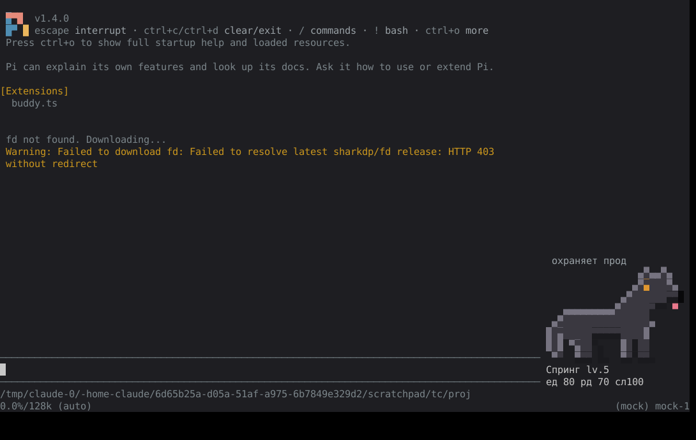

# @euhenio/pi-buddy

Тамагочи для [pi](https://pi.dev): питомец живёт в полосе справа от поля ввода и реагирует на работу агента — идёт, пока агент работает, виляет хвостом после успешного хода, грустит на ошибках, засыпает в простое.



## Установка

```bash
pi install ./pi-buddy                              # из локальной папки
pi install git:github.com/<you>/pi-buddy@v1.0.0    # из git
pi install npm:@euhenio/pi-buddy                   # из npm
```

Попробовать без установки: `pi -e ./pi-buddy`.

> Если раньше расширение лежало файлом в `~/.pi/agent/extensions/buddy.ts` — удалите тот файл,
> иначе будут две команды `/buddy`. Питомец сохранится: его состояние в `~/.pi/agent/buddy.json`.

## Анимация

У каждого питомца — пиксельный спрайт и 30 кадров: моргание, свои «фирменные» движения в простое
(кот машет хвостом и умывается, утка кивает, сова подмигивает, дракон пускает дымок…), ходьба,
пока агент работает, прыжки от радости, позы «лежит», «грустит» и «спит» с дыханием.
Во время работы агента питомец показывает, чем тот занят: думает, ищет (агент читает код), работает
(правит файлы), настороже (команда в терминале), сидит и ждёт (тесты, сборка, субагенты), а на зелёных
тестах подаёт голос. Позы у каждого свои: собака нюхает след и гавкает, кот крадётся и закапывает баг,
утка ныряет хвостом вверх и высиживает билд в гнезде, сова листает книгу и ухает, дракон роет сокровища
и выдыхает пламя, призрак ищет с лупой и пугает «бу!», аксолотль роет песок и пускает пузыри,
блоб шлёпает ложноножками. Каждая поза держится не меньше 3 секунд.
Смена анимаций идёт через базовую стойку, без резких скачков. В простое питомец иногда
сам берёт любимую игрушку.

### Субагенты — «стая»

Когда агент запускает субагентов (инструмент `subagent` из примеров pi и похожие — `task`, `delegate`, `spawn_agents`…),
над питомцем появляются его мини-копии (щенки, котята, утята…), по одному на субагента (до трёх, остальные — `+N`).
Каждый щенок показывает, чем занят его субагент: нюхает, копает, сидит на тестах, виляет хвостом на ✓, грустит на ✗;
в цепочке (`chain`) следующие ждут своей очереди. Сам питомец в это время сидит и «пасёт стаю», а когда все вернутся —
гавкает. Фоновые запуски [pi-subagents](https://github.com/nicobailon/pi-subagents) (`async`) тоже понимает: инструмент возвращается сразу,
а стая бегает, пока субагент действительно не закончит (живой статус берётся из его `status.json`). Опыт за работу субагентов начисляется питомцу родительской сессии (сами дочерние pi-процессы состояние не трогают).

## Команды

| Команда | Что делает |
|---|---|
| `/buddy` | показать / спрятать |
| `/buddy choose [вид]` | выбрать питомца: ВЕО (пиксели), немецкая овчарка, блоб, кот, утка, призрак, сова, аксолотль, дракон — все пиксельные, с анимацией |
| `/buddy feed` `pet` `nap` | покормить, погладить, уложить |
| `/buddy play [предмет]` | поиграть любимой игрушкой: у каждого их две (мячик и косточка, клубок и мышка, фрисби и канат…) |
| `/buddy name <кличка>` | дать имя |
| `/buddy stats` | статистика |
| `/buddy dock` `compact` `big` `top` | где и как показывать |
| `/buddy mute` `unmute` | болтовня выкл/вкл |
| `/buddy anim on\|off\|auto` | анимация (auto — не мешает прокрутке вне fullscreen) |
| `/buddy pxcolor fg\|bg\|auto` | отрисовка пиксельного пса (fg — для терминала IntelliJ) |
| `/buddy bark` (`голос`) | подать голос: гав, мяу, кря, уху… |
| `/buddy learn [тема\|пожелание]` | модель pi придумает новые фразы |
| `/buddy phrases` / `phrases clean` | файл своих фраз / убрать те, что не прозвучат (длинные, не та поза) |

В чате можно попросить агента: «добавь питомцу фраз про Kafka» — он вызовет инструмент `buddy_phrases`.

## Файлы

- `~/.pi/agent/buddy.json` — состояние питомца
- `~/.pi/agent/buddy.json.bak` — предыдущая сохранённая версия для восстановления
- `~/.pi/agent/buddy-phrases.json` — свои и выученные фразы

Опыт сохраняется после каждого хода модели, в конце запроса и раз в 30 секунд во время работы.
Терминалы сливают прогресс под общей файловой блокировкой (`buddy.json.lock`), поэтому их
одновременные сохранения не перезаписывают друг друга. Дочерние процессы без интерфейса прогресс не сохраняют.
При ошибке сохранения прогресс остаётся в памяти до следующей попытки, а pi показывает предупреждение.
Если основной файл повреждён, читается резервная копия. Если обе версии не читаются,
расширение сообщает об ошибке, а не создаёт нового питомца поверх старого состояния.
Явная команда `/buddy hatch` по-прежнему создаёт нового питомца со сбросом опыта.

Расширение само в сеть не ходит; к модели pi обращаются только `/buddy learn` и инструмент `buddy_phrases`.

## Устройство кода

Расширение — обычные TypeScript-модули: pi загружает их сам, сборка не нужна, зависимостей нет.
`extensions/buddy.ts` — точка входа, весь код в `src/`, разложен по слоям (зависимости идут только внутрь):

| Слой | Что там |
|---|---|
| `src/domain` | правила питомца (шкалы, опыт, слияние между терминалами), настроение, автомат поз (очередь занятий, долгое «думает», переходы), стая субагентов, речь. Чистая логика, без файлов и экрана |
| `src/content` | данные: пиксельные спрайты, палитра, фразы, виды, любимые предметы |
| `src/app` | приложение: `BuddyApp` (сценарии на события агента, таймер), команды `/buddy`, обучение фразам; порты — интерфейсы к внешнему миру |
| `src/adapters` | pi (события, команда, инструмент `buddy_phrases`), экран (полоса dock, compact/big/top, полублочные пиксели), файлы (`buddy.json`, свои фразы, `status.json` субагентов) |

После `npm ci`: тесты домена, приложения и хранилища — `npm test`, проверка типов — `npm run typecheck`.
